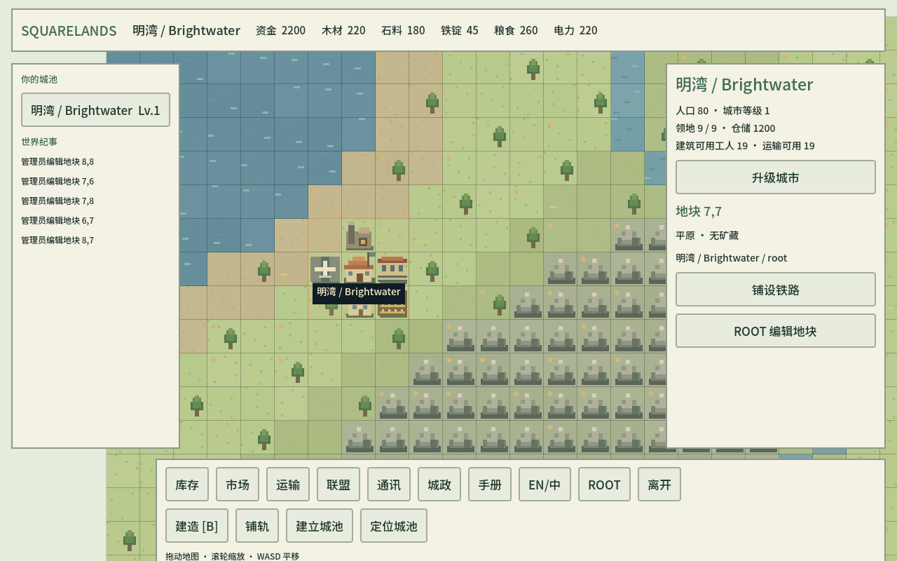

# Squarelands

**A pixel-art multiplayer city builder and trading game. Native Godot client, authoritative Node.js server.**

[简体中文](readme.md) · [Native client](godot/README.md) · [TCP protocol](docs/TCP_PROTOCOL.md) · [Releases](https://github.com/stalyx-meow/Squarelands/releases)



## Version 2.0

Godot 4.7 replaces the web-style client with a native 2D map, pixel terrain/buildings, repeated placement, territory borders, freight animations and keyboard controls. Inventory, markets, logistics, alliance membership, messages, city automation and root tools use native UI. Chinese and English are supported, with a bundled Chinese font.

The client uses a direct TCP connection, default **3211**, with framed JSON and pushed state every two seconds. Unchanged map tiles are cached. Existing accounts, saves and game rules remain compatible. The legacy web endpoint stays on **3210**; the Godot client requires the updated TCP server.

## Play

Download the Windows x86_64, Linux x86_64 or macOS universal client from Releases. Extract before running. Windows/Linux require `Squarelands.pck` beside the executable; macOS stores it inside the app. Binaries are unsigned.

Existing v1.2.1 server launchers can install the new `.squarelands-update.gz`: stop, back up, install, restart. Their TCP port defaults to the web port plus one (3211 normally); old launchers may still show only the web URL. New launcher builds expose a separate TCP port setting.

Enter `192.168.1.10:3211`, `game.example.com:3211`, or `tls://game.example.com:3211`. Open/forward the TCP port; an HTTP reverse proxy does not forward raw TCP. For public deployments configure TLS certificates; see [deployment/protocol details](docs/TCP_PROTOCOL.md).

## Controls

Drag or WASD to pan, mouse wheel to zoom, click to select. **B** opens construction, **Tab** inventory, **Esc** closes/cancels, **F11** toggles fullscreen. A selected build tool stays active for repeated placement. Cities are on the left, tile details on the right, command menus at the bottom.

## Rules

City upgrades expand claim capacity; tiles must be claimed manually. Default max level is five. Builder/freight reserves default to four each. Refine ores into ingots and oil into fuel. Residents consume several everyday goods. Storage is per resource, money uncapped. Automatic restock defaults to 5% of capacity, sale retention to 95%; customize/disable by resource. Recurring transfers are available.

Rail carries 250 units per worker, air 500, normal freight 50. Eligible affordable rail/air with enough crew takes priority. Rail favors short trips, air long trips, crossing at about 50 equal-distance tiles. Rail has a separate layer and supports owned water tiles. Stations/airports directly access city inventory; both endpoints need operating facilities. Railway must connect station tiles; air needs fuel. Normal freight shows dispatch-time fallback reasons.

Alliances support invitations, applications and approval, removal, departure, administrators, internal discounts/tariffs and external embargoes. Broadcasts are public, whispers private, alliance chat current-member-only. Freight visibility is restricted to participants, including root. Root can edit accounts, tiles and buildings, and adjust 439 world settings.

## Development

Node.js 24+ and Godot 4.7 stable are required. Set `GODOT` if the executable is not on PATH; macOS detects `/Applications/Godot.app`.

```sh
npm ci
HOST=0.0.0.0 PORT=3210 TCP_PORT=3211 npm start
npm run desktop
```

`npm test` checks game rules, persistence and both transports. `npm run check:godot` validates scripts; `npm run test:godot` runs a real native client against a disposable TCP server. `npm run pack:godot` exports Windows/Linux/macOS with matching official templates. `npm run pack:update` makes the small server update. Legacy Electron UI remains available via `npm run desktop:web`.

Install future cross-platform `.pck` updates through Local updates on the login screen (also available in Guide); restart to apply or restore bundled resources. Updates live outside signed application bundles, avoiding another runtime download. [Update instructions](godot/README.md#后续客户端小更新). Server and client update formats are distinct.

## Saves and licenses

Accounts/world remain in server `game.sqlite`. Stop the server and back up the whole world directory before upgrading. Version 2.0 retains schema 2; switching clients does not migrate or reset saves. Downgrades require the matching pre-update database. The world freezes while the server is stopped.

Source: [MIT](LICENSE). Noto Sans SC: [SIL OFL](godot/assets/OFL.txt). Godot Engine: MIT; retain engine copyright/license notices in exported distributions.
