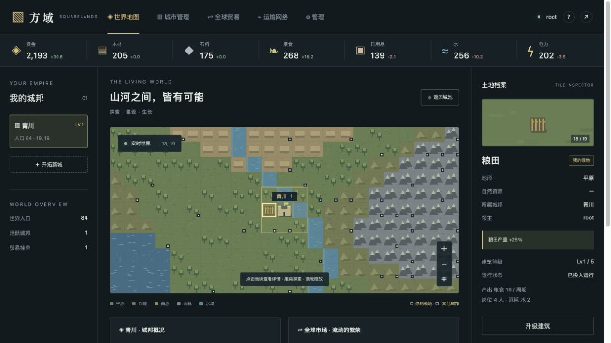
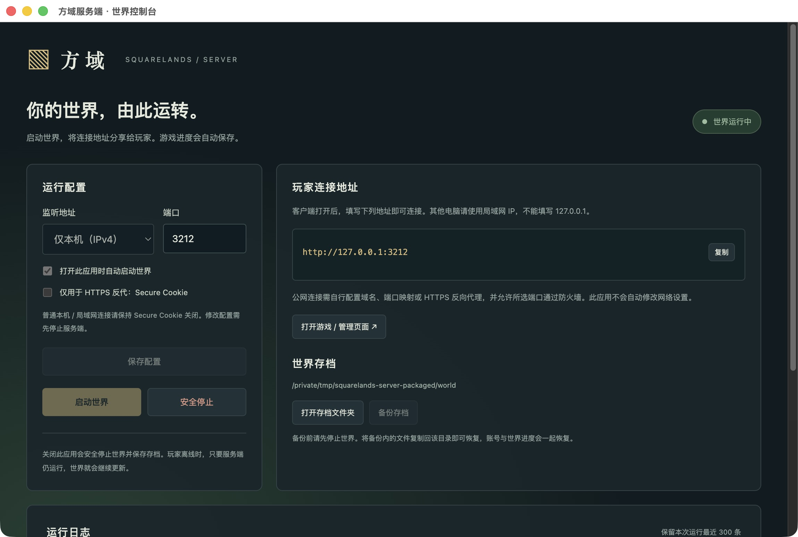
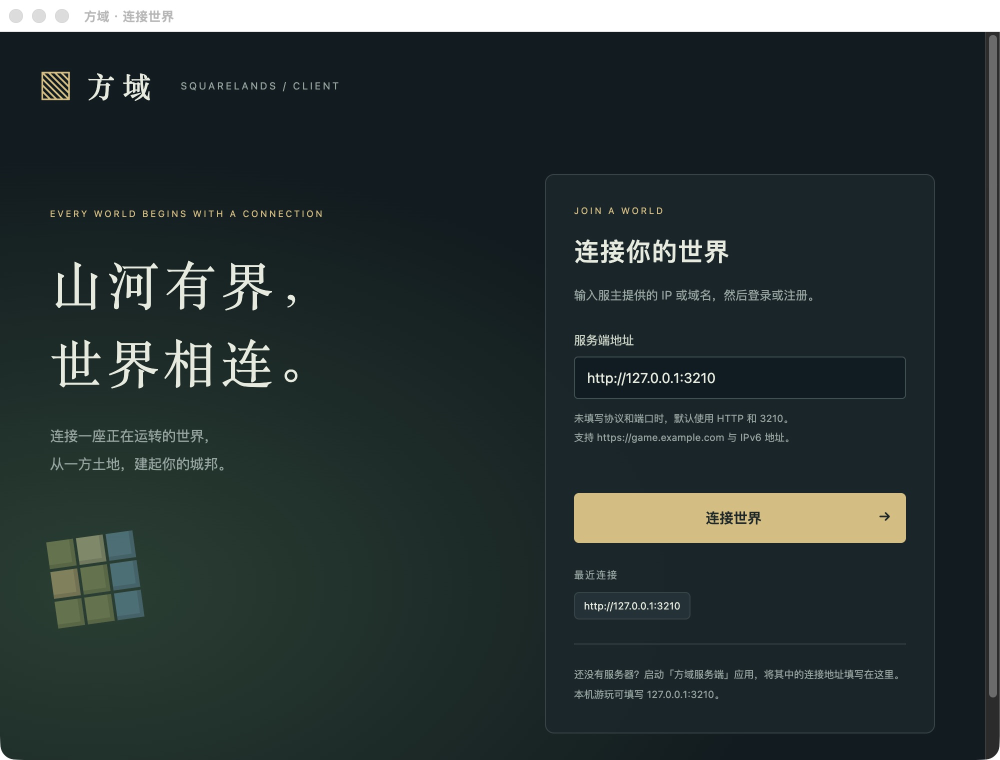

<div align="center">


# 方域 · Squarelands

**从一方土地，到万家灯火。**

一款以城市建设、资源生产和玩家贸易为核心的多人经营游戏。  
独立服务端管理共享世界，Electron 客户端连接后即可游玩。

[English](README.en.md) · [下载应用](https://github.com/stalyx-meow/Squarelands/releases/latest) · [快速开始](#快速开始) · [玩法与数值](GAMEPLAY.md) · [开发与打包](DEVELOPMENT.md)

</div>



## 1.3 更新 · 联盟与现代运输

- **统一自动化**：补货默认 5%、出售默认保留 95%，随容量变化；运输工人独立预留，默认 4 人。
- **铁路与航空**：火车站需连续铁路，铁路独立图层可与建筑共存；两端机场有电力、燃油时可航空运输。
- **联盟与国家**：邀请加入、申请审批、移出成员与主动退出、任命管理员、内部优惠与对外禁运/关税、联盟聊天，玩家自定义势力颜色。
- **领地操作**：交界自有城池间转让地块，或放弃空地；删除边境渗透。
- **管理与体验**：root 单元格/设施属性编辑、用户账号密码管理；缺货快捷调拨/购买、版本公告、移动端适配；货运仅参与方可见。

完整规则见[玩法手册](GAMEPLAY.md)。升级前停止并备份世界；若回退 1.3 前的代码，应同时恢复升级前存档。

## 轻量更新（1.2.1 起）

普通玩法、界面和数值逻辑更新只发布一个百余 KiB 的 `Squarelands-Update-版本.squarelands-update.gz`，Windows、Linux、macOS 通用。客户端从服务端加载游戏页面，重新连接即可获取新版，无需重复下载客户端。

1. **首次准备**：旧服务端 1.2.0 及以前没有安装入口，需要一次性换用 1.2.1 或更高版本的服务端完整应用；原存档目录保持不变。已有 1.2.0 客户端可以继续使用。
2. 在服务端控制台“安全停止”，并点击“备份存档”。
3. 下载官方 Release 的通用更新包，在“代码更新”点击“安装更新”，选择原文件（无需解压）。
4. 启动世界，客户端重新连接。控制台显示当前 Core 版本。

更新包只替换游戏代码，不包含 Electron 运行时，也不会覆盖世界、账号和控制台设置。安装前检查格式、路径和逐文件 SHA-256；校验不能证明发布者身份，请仅使用可信来源。出现问题可停止世界后“回退代码”；回退不恢复存档。本更新格式仅适用于存档结构 2、运行时接口 1，未来不兼容迁移需要新的升级方案。

只有 Electron、安全补丁或原生启动器变更时，才重新发布受影响的完整应用。完整应用保留作首次安装入口；日常更新不再上传 8 份大包。源码标签自动发布小包，完整桌面构建在 GitHub Actions 手动触发。

## 你可以做什么

- **开拓城邦**：探索初始 40 × 32 的随机地图，靠近边缘自动扩图；升级增加领地容量，地块由玩家手动解锁。
- **组织生产**：开采原矿并精炼为锭、燃油；经营粮田、菜田、食品和衣物生产链，自动跨城补给、按库存阈值出售。
- **照顾居民**：用住房、学校、公园、医院与商场提升城市生活；人口随舒适度和居住空间变化。
- **连接世界**：与其他玩家交易现货或签订未来产能合约，安排运输，为不同玩家制定通行政策，处理沿途关税与禁运；出售、收购城池，创建联盟、经营铁路与航空网络。
- **经营服务器**：使用可视化控制台启动、停止、备份世界；root 管理账号、资源与世界状态，并在分组面板调整 434 项数值。
- **交流与语言**：全服广播、玩家私信，中英界面与内置玩法手册。

## 下载与选择版本

> 当前游戏代码版本为 **1.3.1**（服务端基础应用 1.2.1，客户端 1.2.0）。下载时请核对版本号；旧版 1.1 不含本次新增玩法。旧截图展示 1.1 界面。

首次使用请下载 [1.2.1 服务端基础应用](https://github.com/stalyx-meow/Squarelands/releases/tag/v1.2.1) 和 [1.2.0 客户端](https://github.com/stalyx-meow/Squarelands/releases/tag/v1.2.0)，再安装 [最新轻量代码包](https://github.com/stalyx-meow/Squarelands/releases/latest)。**所有包均内置运行时，不需要安装 Node.js、npm 或数据库。**

| 你的设备 | 客户端：供玩家游玩 | 服务端：供服主运行世界 |
| --- | --- | --- |
| Windows x64 | `Squarelands-Client-1.2.0-win-x64.zip` | `Squarelands-Server-1.2.1-win-x64.zip` |
| Linux x64 | `Squarelands-Client-1.2.0-linux-x64.tar.gz` | `Squarelands-Server-1.2.1-linux-x64.tar.gz` |
| macOS Apple 芯片 | `Squarelands-Client-1.2.0-mac-arm64.zip` | `Squarelands-Server-1.2.1-mac-arm64.zip` |
| macOS Intel | `Squarelands-Client-1.2.0-mac-x64.zip` | `Squarelands-Server-1.2.1-mac-x64.zip` |

当前发行形式是**解压即用的便携应用**，不是安装向导。Windows、Linux 包请保留整个解压目录；macOS 将 `.app` 拖入“应用程序”即可。Linux 服务端图形应用同样需要桌面环境，无桌面的服务器可使用[命令行运行方式](DEVELOPMENT.md#无图形界面的服务端)。

> 当前发布包未做发行者代码签名或 Apple 公证，系统可能提示未知发布者。macOS 版本配置最低系统为 12.0；其他平台需要满足所捆绑 Electron 版本的系统及图形库要求。Apple 芯片与 Intel 包不可混用。发行包校验和随 Release 提供。

## 快速开始

### 1. 服主：打开服务端

1. 解压 **Server** 包，运行 `Squarelands Server`；Linux 运行 `squarelands-server`。
2. 控制台默认自动启动世界，监听 `0.0.0.0:3210`。看到“世界运行中”即已启动。
3. 首次创建存档时，控制台显示 **root 初始密码**，请保存。它不会写入运行日志，也不会在后续启动时重新生成。
4. 将“玩家连接地址”中的局域网地址发给玩家，例如 `http://192.168.1.10:3210`。

服主可以在控制台安全停服、修改端口与监听范围、打开存档目录，以及备份存档。关闭应用会先保存世界，再停止后台进程。

<details>
<summary>查看服务端控制台实测画面</summary>



</details>

### 2. 玩家：填写地址，连接世界

1. 解压 **Client** 包，运行 `Squarelands Client`；Linux 运行 `squarelands-client`。
2. 在“服务端地址”填写服主提供的 IP 或域名，点击“连接世界”。
3. 在游戏页注册账号或登录。不同服务端的账号与城市分别保存。
4. 点击“开拓新城”，选择无主的平原、丘陵或高原，并为城池命名。首城免费，25 秒后建成。

| 输入示例 | 连接结果 |
| --- | --- |
| `127.0.0.1` | 本机 `http://127.0.0.1:3210` |
| `192.168.1.10:3210` | 指定局域网地址与端口 |
| `game.example.com` | `http://game.example.com:3210` |
| `https://game.example.com` | HTTPS，默认端口 443 |
| `[::1]:3210` | IPv6 本机地址 |

不填写协议时默认 HTTP，不填写端口时默认 3210；显式输入 `http://` 或 `https://` 则遵循该协议的默认端口。不要附加页面路径、查询参数或账号密码。客户端会先检查是否为兼容的方域服务端，并记住最近 6 个成功连接的地址。

**同一台电脑游玩**：同时运行服务端和客户端，客户端填 `127.0.0.1:3210`。  
**更换服务器**：关闭游戏窗口返回连接页，或使用菜单“游戏 → 切换服务器”。

<details>
<summary>查看客户端连接页实测画面</summary>



</details>

### 3. 新手建议：先让城市自给自足

点击自己黄色领地内的空地建造。建议顺序为：

**先确保粮、水、电，再补齐蔬菜、主食、衣物与肉制品供应链。**

一级城地块有限；可以先用商城补足民生，升级后手动解锁相邻地块，再扩建工厂。粮田与菜田可免费转换。

- 优先在河流或湖泊附近定居；水厂必须与水源四方向相邻。
- 顶部保留资金摘要，独立“仓储”页分类展示全部库存及每周期净变化。默认每 30 秒一周期、每 2 秒结算，服主可以调整。
- 公务、生产、施工和运输都占用人力。缺工、缺电或缺原料会影响产出。
- 每种物资初始仓储上限为 600，仓库可扩容；资金不限容量。
- 必需品短缺会降低舒适度；舒适度低于 40 时人口流失，达到 60 且有空房时人口增长。
- 游戏右上角“?”提供玩法说明；完整建筑成本、产出和经济公式见 [GAMEPLAY.md](GAMEPLAY.md)。

## 服务端与管理

### 两个管理入口

| 入口 | 用途 |
| --- | --- |
| **服务端 App 的世界控制台** | 启停服务、监听地址和端口、开 App 自动运行、连接地址、初始密码、日志、打开存档目录、停服备份 |
| **游戏内 root 管理面板** | 暂停/恢复模拟、商城补货、发放物资、封禁/解封账号、编辑用户账号密码、地块与设施属性、434 项世界参数、重置世界 |

root 在客户端或浏览器的游戏登录页登录后，会出现“管理”入口。root 改密使已有 root 会话失效；封禁使该玩家会话失效。**“重置世界”会清空城市、资源、订单、合约和运输，但保留账号**，执行前须输入确认文字。

### 存档、备份与恢复

服务端默认每 2 秒保存一次（可随结算间隔调整），安全停止时再次保存。存档放在用户数据目录，**不会写进 `.app`、`.exe` 或应用解压目录**，替换应用包不会自动清空进度。

| 系统 | 服务端 App 默认世界目录 |
| --- | --- |
| Windows | `%APPDATA%\Squarelands Server\world` |
| macOS | `~/Library/Application Support/Squarelands Server/world` |
| Linux | `${XDG_CONFIG_HOME:-~/.config}/Squarelands Server/world` |

以控制台显示的实际路径为准。同目录的 `server-config.json` 保存监听配置，不保存 root 明文密码。

- **备份**：安全停止 → “备份存档” → 选择保存位置。
- **恢复/迁移**：停止服务端，将备份里的文件复制到控制台显示的世界目录，再启动。账号与会话会一起恢复。
- **升级**：停止旧版、备份世界，再替换应用。不要同时用两个服务端打开同一份存档。
- 玩家离线时世界继续运行；服务端停止或世界被暂停时，生产、施工、运输和合约计时冻结，恢复后继续。
- 1.0 开发版的项目 `data/` 或旧桌面版 `world/` 不会自动迁入新目录；可停服后手动复制存档。

## 局域网与公网

**局域网**：双方位于同一可互通网络；服务端监听“所有网卡”；允许端口通过服主机器的防火墙。其他电脑不能用 `127.0.0.1`，因为该地址总是指向玩家自己的电脑。

**公网**：需要可达的公网 IP、端口映射、隧道或域名。客户端填写实际公开地址。本应用不会自动修改路由器、防火墙或系统代理。

反向代理只有在 `TRUSTED_PROXIES` 明确列出可信代理 IP/CIDR 时，才读取其 `X-Forwarded-For`；否则忽略。写操作按账号限流，登录按账号与来源组合限流，超限返回 429 和 Retry-After。

对外部署建议由 HTTPS 反向代理转发到服务端端口，并保留原始 `Host`。启用 HTTPS 后再打开控制台的“Secure Cookie”；普通 HTTP 本机或局域网连接应保持关闭。反向代理示例见 [开发文档](DEVELOPMENT.md#https-反向代理示例)。

浏览器也可以打开同一服务端地址，与 Electron 使用相同的游戏界面和账号体系。

## 从源码运行

开发环境需要 **Node.js 24+**。首次安装需联网下载 Electron。

```sh
npm ci
npm run server:app   # 图形服务端
```

另一个终端运行客户端：

```sh
npm run desktop     # 填写地址后连接
```

只运行命令行服务端：

```sh
npm run server      # 默认 127.0.0.1:3210
```

客户端现在不会自动启动服务端。旧版本通过环境变量启动本地世界的行为已移除；`GAME_SERVER_URL` 只作为连接页的初始地址。

## v1.2 存档与语言

旧存档加载前自动保留迁移 JSON 备份，不重新计算已有合约货款；损坏库存会明确报错。升级前请先停服并完整备份。root 参数保存于世界存档中；初始库存只影响新城、地图尺寸只影响重置后的新世界。详见[玩法手册](GAMEPLAY.md#root-调参与存档升级)。

游戏登录页、账号栏及两个启动窗口均有语言按钮，支持中文 / English。玩家输入的名字、城名和消息保留原文，服务端运行日志也保留原始文本。

## 构建与验证

```sh
npm run check       # 全部 JS 语法检查
npm test            # 规则、HTTP、连接地址与进程生命周期测试
npm run pack        # 当前系统的客户端 + 服务端
npm run pack:all    # 在 macOS 上生成本次发行的全部 8 个包
```

单独构建示例：

```sh
node scripts/package.mjs client win x64
node scripts/package.mjs server linux x64
node scripts/package.mjs all mac arm64
```

输出目录为 `dist/client/` 和 `dist/server/`，每个目录附有 `SHA256SUMS.txt`。macOS 构建需使用 macOS 主机。`pack:all` 默认产出 Windows x64、Linux x64、macOS arm64/x64；脚本也接受单独的 arm64 架构参数，但非默认发行架构未经本次验证。

macOS 打包脚本会读取系统已启用的 HTTPS 代理，仅用于下载，不修改系统设置。也可以显式设置 `SQUARELANDS_BUILD_PROXY`。Electron 下载使用固定版本 npm 包附带的官方 SHA-256 校验值。

仓库提供 [GitHub Actions 工作流](.github/workflows/release.yml)：推送 `v*` 标签或手动运行后，分别构建两种应用并上传为 Actions Artifacts。**工作流不会自动发布 Release**；本次发行包单独上传到 Releases。更多说明见 [DEVELOPMENT.md](DEVELOPMENT.md)。

## 常见问题

<details>
<summary><strong>连接失败 / 地址不是兼容的服务端</strong></summary>

先确认控制台显示“世界运行中”，再核对地址和端口。检查防火墙、双方网络与服务端监听范围。浏览器访问 `http://地址:端口/api/health` 应返回 `service: squarelands`。旧版没有健康检查接口的服务端需要升级。

</details>

<details>
<summary><strong>服务端提示端口被占用</strong></summary>

停止占用该端口的旧服务端，或在控制台换一个端口后启动。玩家连接地址也要使用新端口。应用不会默默接管另一个已运行的服务。

</details>

<details>
<summary><strong>忘了 root 密码怎么办？</strong></summary>

如果仍有 root 登录会话，可在管理面板修改密码。当前不提供邮件找回或 GUI 离线重置；不要删除世界存档来尝试找回密码。命令行 `ROOT_PASSWORD` 只在首次初始化 root 时生效，不会覆盖已有密码。

</details>

<details>
<summary><strong>Linux 无法启动 / 缺少库 / 沙箱错误</strong></summary>

请使用具有图形桌面的兼容 Linux 发行版，并按系统提示安装 Electron 所需的 GTK、NSS 等运行库。使用普通用户运行；不要以关闭沙箱作为默认运行方式。无桌面的主机使用命令行服务端。

</details>

<details>
<summary><strong>应用升级后看不到旧世界</strong></summary>

先在控制台检查实际存档路径。图形服务端、旧桌面版和命令行服务端的默认存档目录不同。停止服务后将旧世界文件复制到当前目录即可迁移，操作前保留备份。

</details>

## 当前范围

当前采用永久矿藏、整单交易和简化人口模型，水域运输无需另建港口；已支持联盟、地图扩容与服务端小包更新。尚未包含战斗、部分撮合和邮件找回。

本次在 macOS Apple 芯片上实测打包后的客户端连接、服务端启动与安全停止；Windows、Linux 和 Intel Mac 包已交叉构建，**未在对应实体系统上进行交互实测**。账号密码使用 scrypt 加盐存储；远程游戏页无 Node 权限，桌面 IPC 仅开放给本地控制台。

原始需求保留于 [docs/ORIGINAL_REQUIREMENTS.md](docs/ORIGINAL_REQUIREMENTS.md)。

## 许可证

本项目原创内容使用 [MIT License](LICENSE)。Electron 及其他第三方组件保留各自的许可证；应用包中的第三方许可文件同样适用。
